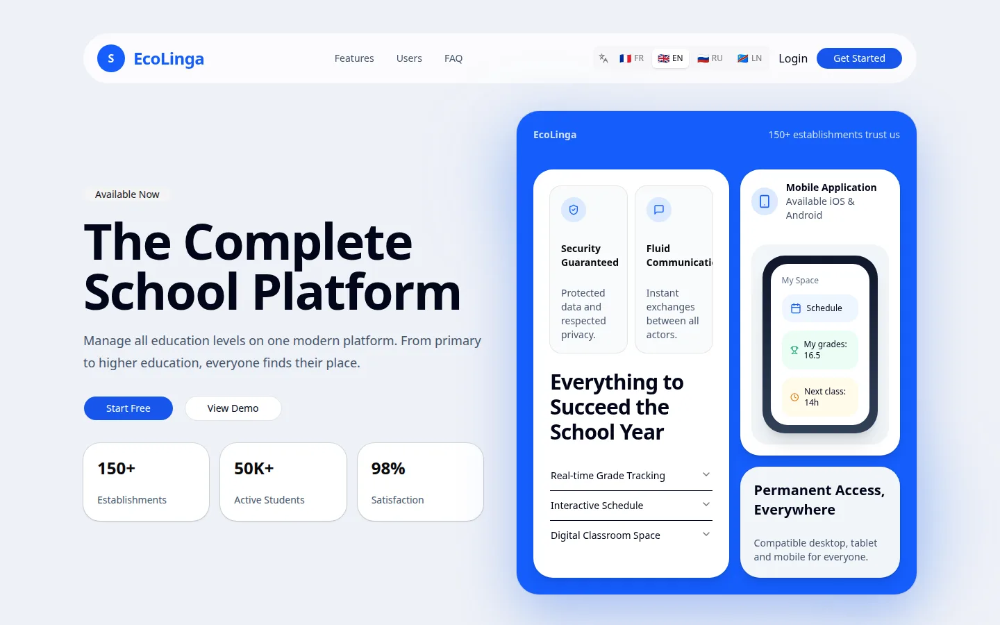
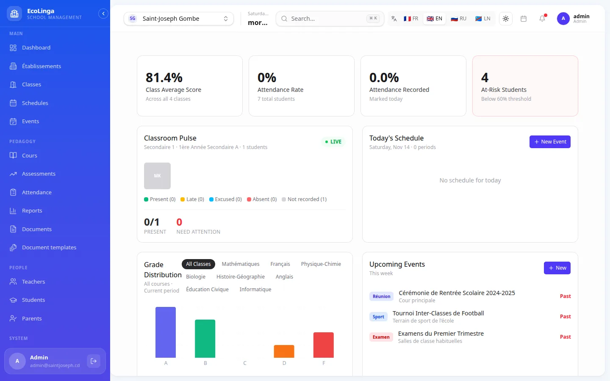
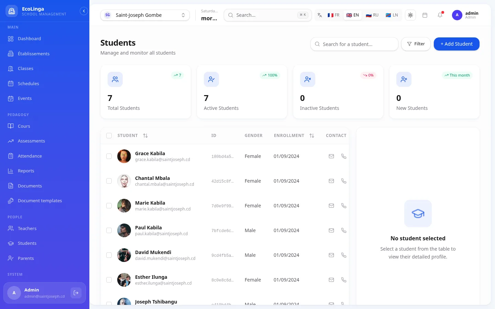
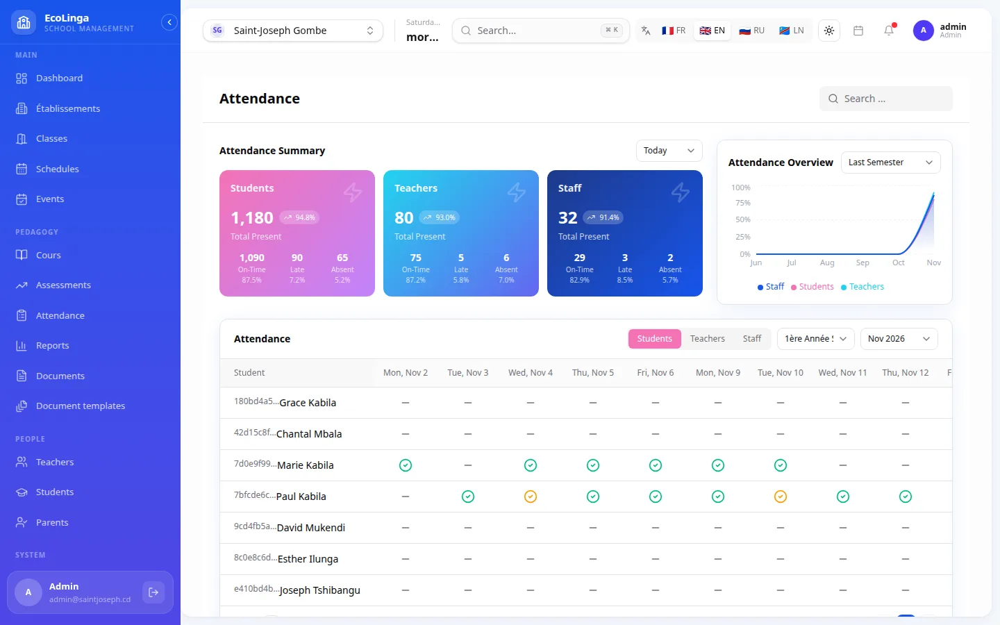
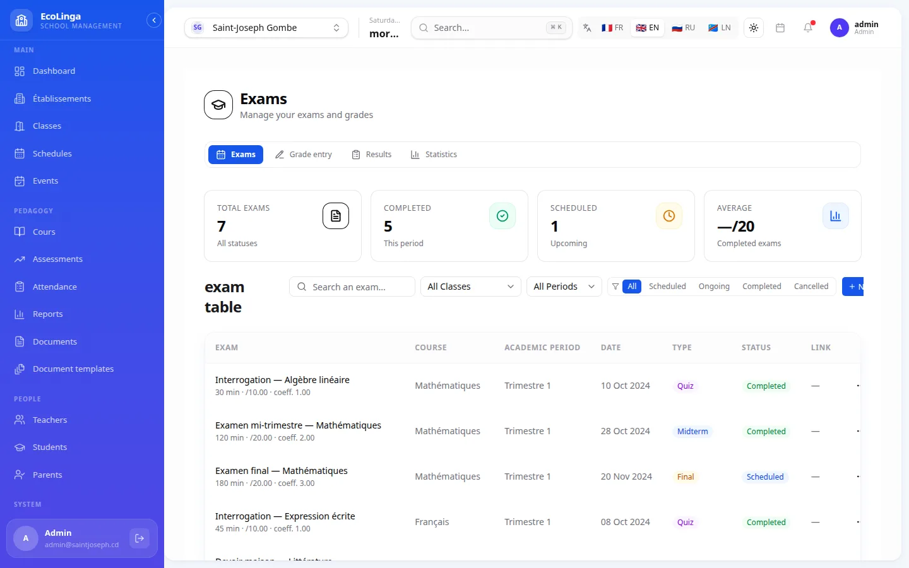
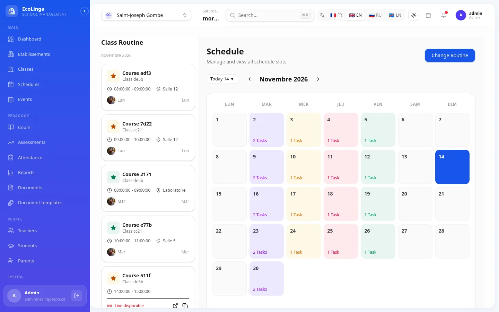
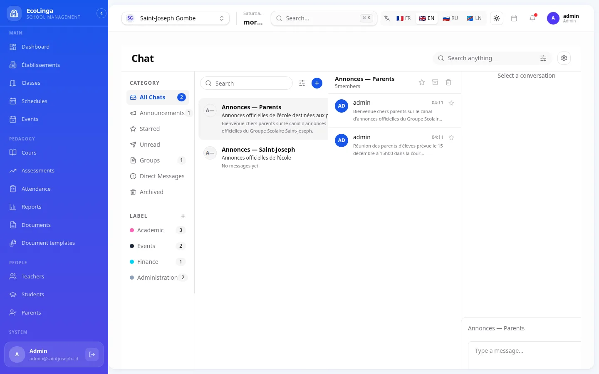
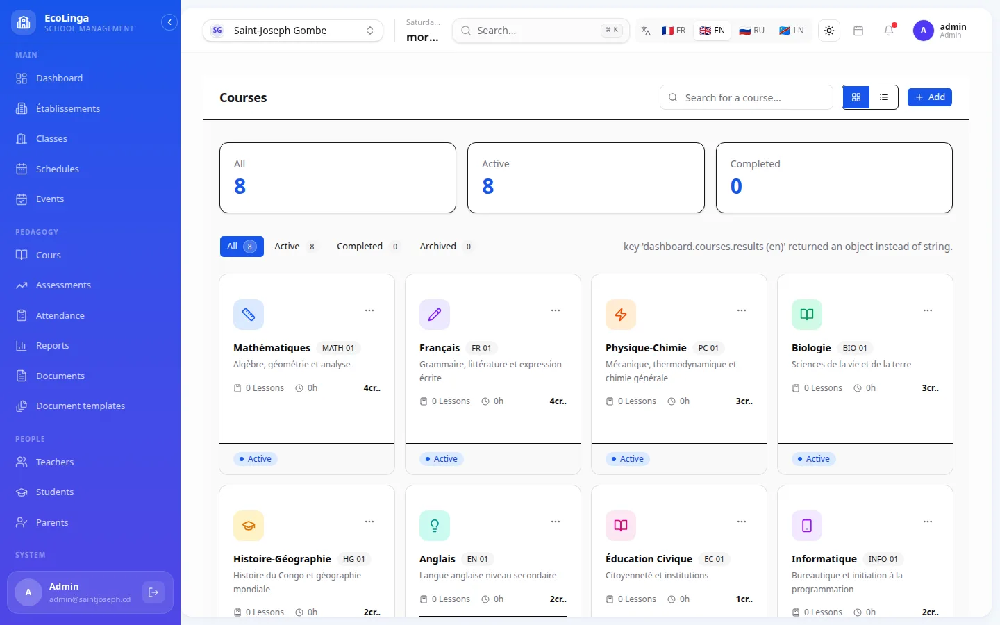
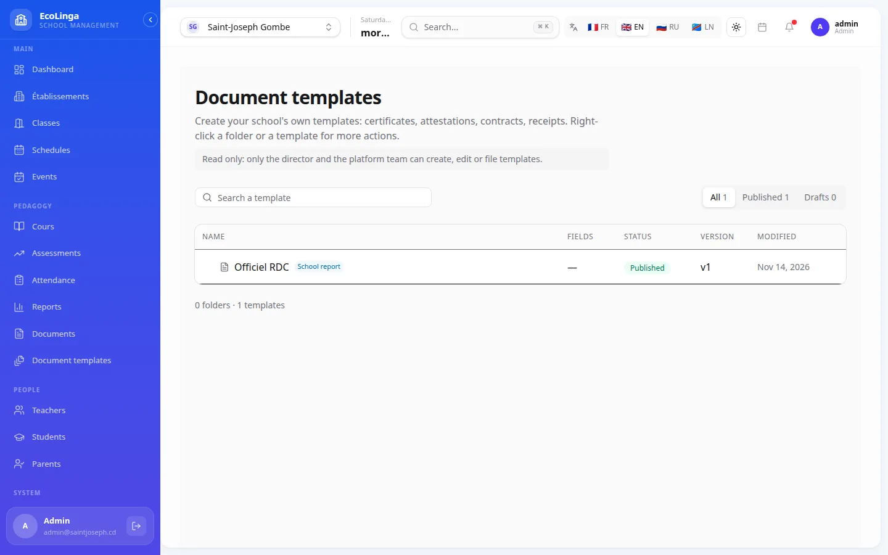

<div align="center">


# EcoLinga

**School management, built for Africa.**

One platform for administrators, teachers, parents and students — on the web, on Windows, macOS and Linux.

[](https://github.com/rudney5000/school-management/actions/workflows/ci.yml)
[](https://github.com/rudney5000/school-management/actions/workflows/release-desktop.yml)

[Features](#features) · [Screenshots](#screenshots) · [Download](#download-the-desktop-app) · [Getting started](#getting-started) · [Architecture](#architecture) · [Roadmap](#roadmap)

</div>

<p align="center">
  
</p>

## Why EcoLinga

Most school software assumes stable internet, card payments and one school per account. Schools across Africa work differently: connections drop, families pay by Mobile Money, and one school group often runs several campuses. EcoLinga is designed around those realities:

- **Multi-school by design** — a school group manages all its campuses (sub-schools) from one account, with each campus's data strictly isolated from the others.
- **Log in with what people actually have** — an email, a phone number or a username. Students and staff without an email address are first-class users.
- **Local languages** — the interface is available in French, English, Lingala and Russian.
- **Official documents that can be trusted** — report cards and certificates are issued with a number, a QR code anyone can scan to verify them, and an audit trail.

## Screenshots

| Dashboard                                                                                                             | Students                                                                                                 |
| --------------------------------------------------------------------------------------------------------------------- | -------------------------------------------------------------------------------------------------------- |
|  |                            |
| **Attendance**                                                                                                        | **Exams and grades**                                                                                     |
|                               |                             |
| **Schedule**                                                                                                          | **Real-time chat**                                                                                       |
|                                                              |                      |
| **Courses**                                                                                                           | **Document templates**                                                                                   |
|                                                       |  |

## Features

### School administration

- **School groups and campuses** — schools, sub-schools, departments, cities and districts.
- **People** — students, teachers, parents and staff, with profiles, contact details and parent–child links.
- **Enrollment** — classes, academic periods (trimesters) and student enrollment, including document uploads.
- **Timetables and events** — class schedules and a school calendar of events.

### Teaching and learning

- **Courses** — a course catalogue per school, linked to classes.
- **Exams and grades** — exam planning and grade entry, with class averages on the dashboard.
- **Report cards** — generated as PDFs from the grades, then signed electronically by the school.
- **Attendance** — separate attendance tracking for students, teachers and staff.
- **Live classes and video calls** — built-in video sessions powered by LiveKit.

### Communication

- **Real-time chat** — direct messages, groups and announcement channels, with file attachments.
- **Incident reports** — students, parents and staff can report harassment or behaviour issues, anonymously if they choose, and follow the status of their report.
- **Parent access** — parents see their own children's grades, attendance and payments, and nothing else.

### Official documents

- **Template editor** — schools design their own certificates, attestations, receipts and report cards from blocks (header, grades table, signatures, QR code…), with versioned templates.
- **Issuing** — documents are numbered, frozen at issue time and stored with a fingerprint.
- **Verification** — the QR code printed on each document opens a public page confirming it is genuine.
- **Policies** — rules such as "only the director can issue" or "only a super admin can revoke" are configured per document type.

### Security

- **Role-based access** — super admin, admin, director, teacher, staff, parent and student, each with its own permissions.
- **Tenant isolation** — every query is scoped to the user's campus; this isolation is covered by automated tests.
- **Hardened authentication** — normalized identifiers, short-lived access tokens, rate limiting and one-time codes (OTP) ready for SMS login.

## Download the desktop app

Installers for every platform are attached to each [GitHub release](https://github.com/rudney5000/school-management/releases/latest):

| System                              | File                                     | How to install                                                                                                             |
| ----------------------------------- | ---------------------------------------- | -------------------------------------------------------------------------------------------------------------------------- |
| **Windows**                         | `EcoLinga_x.y.z_x64-setup.exe` or `.msi` | Double-click. If Windows SmartScreen appears, choose **More info → Run anyway** (the installer is not code-signed yet).    |
| **macOS** (Apple Silicon and Intel) | `EcoLinga_x.y.z_universal.dmg`           | Open the `.dmg` and drag EcoLinga to Applications. On first launch, **right-click → Open** (the app is not notarized yet). |
| **Ubuntu / Debian**                 | `.deb`                                   | `sudo apt install ./EcoLinga_x.y.z_amd64.deb`                                                                              |
| **Fedora / RHEL**                   | `.rpm`                                   | `sudo dnf install ./EcoLinga-x.y.z-1.x86_64.rpm`                                                                           |
| **Any Linux**                       | `.AppImage`                              | `chmod +x EcoLinga_x.y.z_amd64.AppImage` then run it.                                                                      |

The desktop app and the web app share the same server: same accounts, same schools, same data. An internet connection is required for now (see the [roadmap](#roadmap)).

## Tech stack

| Layer         | Technologies                                                                                                                                                                       |
| ------------- | ---------------------------------------------------------------------------------------------------------------------------------------------------------------------------------- |
| **Frontend**  | React 19, TypeScript, Vite, TanStack Router and Query, Redux Toolkit, Tailwind CSS 4, shadcn/ui, i18next — structured with [Feature-Sliced Design](https://feature-sliced.design/) |
| **Desktop**   | Tauri 2 (Windows, macOS, Linux; Android planned)                                                                                                                                   |
| **Backend**   | Node.js 22, Express, TypeScript, Zod, Drizzle ORM, Socket.IO                                                                                                                       |
| **Data**      | PostgreSQL 16, Redis 7, S3-compatible object storage (MinIO)                                                                                                                       |
| **Documents** | React-PDF, inside the `@school-hub/documents` engine                                                                                                                               |
| **Video**     | LiveKit                                                                                                                                                                            |
| **Quality**   | Vitest, ESLint, Prettier, Husky, GitHub Actions                                                                                                                                    |
| **Hosting**   | Render (API), Vercel (web app), GitHub Releases (desktop installers)                                                                                                               |

## Architecture

```
school-management/
├── frontend/              React web app + Tauri desktop shell (src-tauri/)
├── backend/               Express API: one module per domain (router → controller → service → schema)
├── packages/
│   ├── documents/         Document engine: templates, rendering, issuing, policies
│   ├── pdf-templates/     Shared PDF components (report cards, certificates)
│   └── documents-spike/   Benchmark that chose the PDF engine (ADR-008)
├── docs/                  Product requirements (PRD), architecture decisions (ADR), screenshots
├── Arch/                  C4 architecture model (Structurizr DSL)
└── scripts/dev.sh         One-command local environment
```

```
 Web app (Vercel) ─┐
                   ├──►  REST API + Socket.IO (Render)  ──►  PostgreSQL · Redis · S3
 Desktop (Tauri) ──┘
```

Architecture decisions are recorded in [`docs/ADR.md`](docs/ADR.md), and the C4 model lives in [`Arch/`](Arch/README.md).

## Getting started

### Prerequisites

- **Node.js 22.13 or later**
- **pnpm 11** — `corepack enable` installs the version pinned in `package.json`
- **Docker** with Docker Compose

A ready-to-use [dev container](.devcontainer/README.md) is also available for VS Code and GitHub Codespaces.

### Run it locally

```bash
git clone https://github.com/rudney5000/school-management.git
cd school-management

# Starts PostgreSQL, Redis, MinIO and LiveKit, creates .env, installs
# dependencies, builds the shared packages and applies the migrations.
pnpm dev:up

# Fills the database with a demo school.
pnpm --filter @school/backend db:seed
pnpm --filter @school/backend db:seed:documents

# Starts the API (http://localhost:3000) and the web app (http://localhost:5173).
pnpm dev
```

Sign in with one of the demo accounts. They all use the password `password123`:

| Role     | Login                                           |
| -------- | ----------------------------------------------- |
| Admin    | `admin@saintjoseph.cd`                          |
| Director | `directeur@saintjoseph.cd`                      |
| Staff    | `secretaire@saintjoseph.cd`                     |
| Teacher  | `jean.muamba@saintjoseph.cd` or `+243812345678` |
| Student  | `marie.kabila@saintjoseph.cd`                   |

`pnpm dev:down` stops the containers and keeps the data.

### Run the desktop app

The desktop app needs the [Tauri prerequisites](https://v2.tauri.app/start/prerequisites/) (Rust and system libraries). Then:

```bash
cd frontend
pnpm tauri dev
```

### Tests and checks

```bash
pnpm --filter @school/backend test        # API tests (needs PostgreSQL and Redis from pnpm dev:up)
pnpm --filter @school-hub/documents test  # document engine tests
pnpm lint && pnpm typecheck && pnpm format:check
```

The same checks run on every pull request.

## Deployment

| What                   | Where           | How                                                                                                                                                                                                              |
| ---------------------- | --------------- | ---------------------------------------------------------------------------------------------------------------------------------------------------------------------------------------------------------------- |
| **API**                | Render          | Deployed automatically once CI is green on `main`. Database migrations run on deploy.                                                                                                                            |
| **Web app**            | Vercel          | Deployed from `main`.                                                                                                                                                                                            |
| **Desktop installers** | GitHub Releases | Push a tag matching the version in `frontend/src-tauri/tauri.conf.json` (for example `v0.2.0`), or run the **Release desktop** workflow. The installers are attached to a draft release, published after review. |

## Roadmap

- [ ] **Offline mode** — keep working without a connection and sync back later ([ADR-003](docs/ADR.md))
- [ ] **SMS notifications and login by SMS code**, through each school's own Android SMS gateway ([ADR-005 to ADR-007](docs/ADR.md))
- [ ] **Mobile Money payments** (Airtel Money, M-Pesa, Orange Money)
- [ ] **Android app**, once the interface is fully responsive
- [ ] **Code signing** for the Windows and macOS installers
- [ ] **Automatic updates** for the desktop app

## Documentation

- [Product requirements (PRD)](docs/PRD.md)
- [Architecture decision records](docs/ADR.md)
- [Domain vocabulary](CONTEXT.md)
- [C4 architecture model](Arch/README.md)
- [Dev container](.devcontainer/README.md)

## License

No license has been chosen yet. Until one is added, all rights are reserved.
